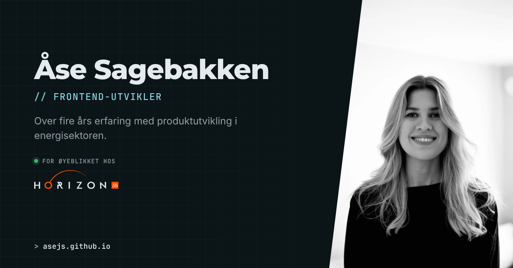

# asejs.github.io



Personal portfolio and CV for Åse Sagebakken – https://asejs.github.io/

Built with Vue 3, Vite and TypeScript. Deployed to GitHub Pages on every push to `main`.

## Development

```bash
npm install
npm run dev
```

All content lives in `src/data.ts`.

## CV

The CV is written in HTML (`cv/cv.html` and `cv/cv.en.html`) and saved as PDF to `public/`:

```bash
npx playwright install chromium   # once, downloads the browser
npm run cv                        # both languages
npm run cv:no                     # Norwegian only
npm run cv:en                     # English only
```

## Tests

```bash
npm test           # run the tests
npm run coverage   # with a coverage report (at least 80 %)
```

The tests use Vitest and Vue Test Utils. The 3D scenes (three.js) are excluded from the coverage requirement.

## Code quality

```bash
npm run lint           # ESLint for Vue and TypeScript
npm run format         # format the code with Prettier
npm run format:check   # check formatting without changing anything
```

CI runs lint, format check, build and tests on every pull request.

## License

The photos are my own, and the logos belong to their respective companies. They may not be reused.
